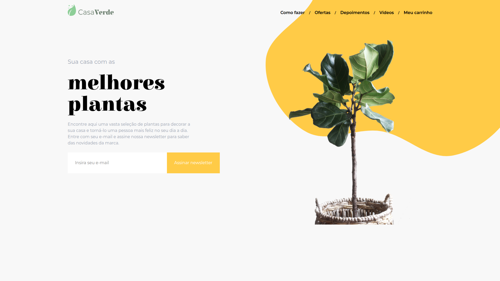

<h1 align="center">🌿 Casa Verde</h1>

<p align="center">
  Landing page de uma loja de plantas, feita com <strong>React</strong> e <strong>Tailwind CSS</strong> a partir de um design no Figma.
</p>

<p align="center">
  
  
  
  
  
</p>

> [!WARNING]
> 🚧 **Projeto em desenvolvimento.** Por enquanto só a primeira seção (navbar e hero) está pronta. As outras partes da página ainda estão sendo construídas, então o layout e o código podem mudar.

<p align="center">
  
</p>

## 📌 Sobre

A Casa Verde é uma loja fictícia de plantas. Este projeto é para estudo e portfólio: a ideia é praticar como transformar um design do Figma em uma interface em React, com componentes reutilizáveis e estilos feitos só com Tailwind CSS.

🎨 **Design no Figma:** [Casa Verde (Alura Community)](https://www.figma.com/design/wC62zMFJUtRaNV6dKSzZF4/Casa-Verde---Alura--Community-?node-id=0-1)

## ✅ Progresso

- [x] Navbar com logo e links
- [x] Hero com título, texto e formulário de newsletter
- [x] Fundo amarelo e imagem da planta
- [ ] Seção "Como conseguir minha planta"
- [ ] Seção de ofertas
- [ ] Responsividade (tablet e celular)
- [ ] Deploy

## 🛠️ Tecnologias

- [React](https://react.dev/)
- [TypeScript](https://www.typescriptlang.org/)
- [Tailwind CSS v4](https://tailwindcss.com/)
- [Vite](https://vite.dev/)

## 🚀 Como rodar

Você precisa ter o [Node.js](https://nodejs.org/) instalado.

```bash
# clone o repositório
git clone <url-do-repositorio>

# entre na pasta
cd casa-verde

# instale as dependências
npm install

# rode o projeto
npm run dev
```

Depois é só abrir o endereço que aparecer no terminal (normalmente `http://localhost:5173`).

## 📚 O que estou aprendendo

- Montar componentes React a partir de um layout do Figma
- Usar o `@theme` do Tailwind v4 para cores e fontes personalizadas
- Posicionar elementos decorativos com `absolute` e `z-index` sem quebrar o resto do layout
- Como as cascade layers do CSS afetam as classes do Tailwind

---

<p align="center">
  Design da <a href="https://www.alura.com.br/">Alura</a>. Código feito para estudo 💚
</p>
